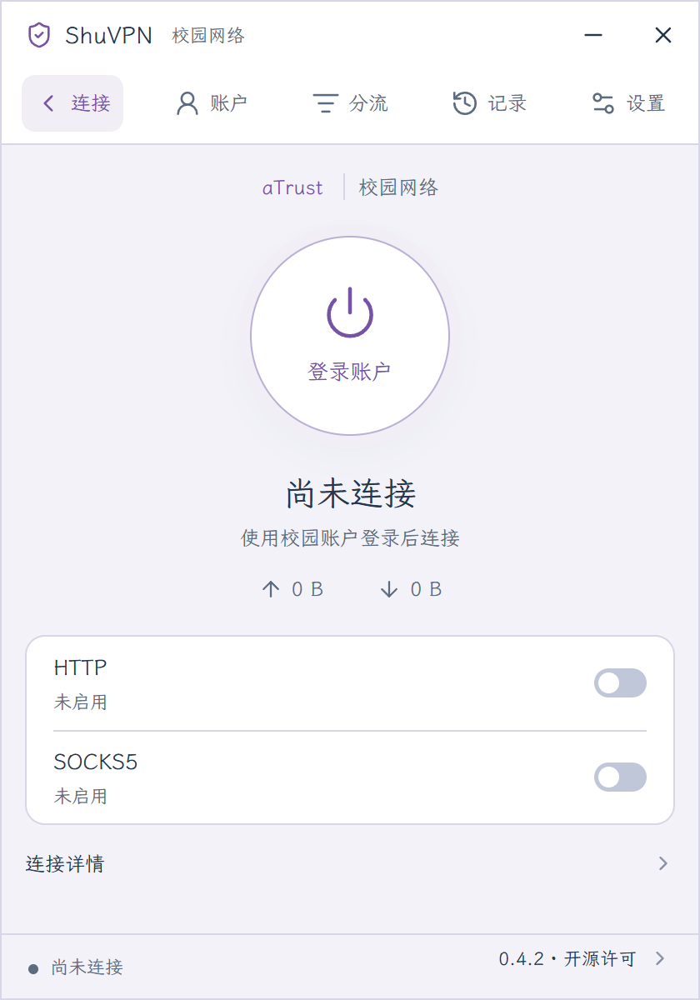
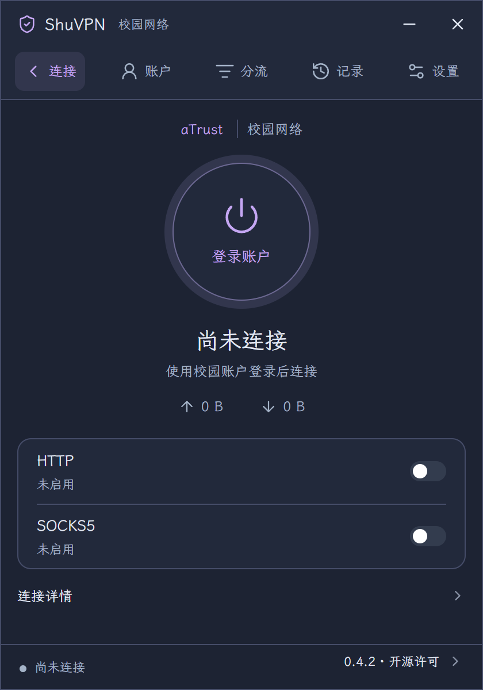

# ShuVPN

连接上海大学校园网络的 Windows 与 Linux 桌面客户端。

**0.6.0** · [下载安装](#下载安装) · [使用指南](docs/user-guide.md) · [自定义主题](docs/themes.md) · [更新记录](CHANGELOG.md)

  
  

- 紧凑的连接界面，显示连接状态、累计流量和本机 HTTP/SOCKS5 代理地址。
- 支持系统代理、TUN 和规则分流，规则修改经过校验和预览后应用。
- 关闭窗口后继续在托盘运行；托盘提供连接、断开、代理设置和常用页面入口。
- 可选开机自启动，支持浅色、深色、跟随系统及四套内置配色。
- 支持自定义主题预览、保存与 JSON 导入导出，内嵌霞鹜文楷 GB 字体。

## 下载安装

从 [GitHub Releases](https://github.com/shuosc/ShuVPN/releases) 获取对应桌面版本的完整安装包。

| 系统 | 推荐安装包 | 便携包 |
| --- | --- | --- |
| Windows 10/11 x64 | `ShuVPN-版本号-windows-x64-setup.exe` | `ShuVPN-版本号-windows-x64.zip` |
| Debian/Ubuntu x64 | `ShuVPN-版本号-linux-x64.deb` | `ShuVPN-版本号-linux-x64.tar.gz` |

Windows 需要 Microsoft Edge WebView2 Runtime。Linux 面向 Ubuntu 22.04 及兼容系统，需要 WebKitGTK 4.1、GTK 3 与 Ayatana AppIndicator 运行库。安装、权限配置和升级步骤见[安装指南](docs/installation.md)。

下载文件旁提供 `.sha256` 校验文件。便携包请完整解压，保留主程序、独立 helper、驱动及许可证之间的目录关系。升级前，从托盘或设置页**退出 ShuVPN**。

## 开始使用

1. 打开“账户”，使用上海大学统一身份认证账户登录，按提示完成身份核验。
2. 按需要启用首页的 HTTP/SOCKS5，或在设置中配置系统代理/TUN。
3. 返回“连接”并点击连接按钮。连接中可取消，连接后可断开。

**右上角关闭按钮只隐藏窗口。** 已有连接和托盘继续运行；再次启动程序会恢复窗口。退出程序请使用托盘“退出 ShuVPN”或设置页的退出按钮。

完整捕获模式标记为实验性，需要显式选择；校园资源访问受账户与学校授权范围限制。遇到问题时请先阅读[使用指南](docs/user-guide.md)，报告中移除密码、验证码、Cookie、Token 和个人信息。

## 参与项目

开发与构建见[开发指南](docs/development.md)，模块边界见[架构](docs/architecture.md)，发布流程见[发布指南](docs/releasing.md)。贡献前请阅读 [CONTRIBUTING.md](CONTRIBUTING.md) 和[行为准则](CODE_OF_CONDUCT.md)；安全问题按 [SECURITY.md](SECURITY.md) 私密报告。

项目采用 [AGPL-3.0](LICENSE)。Pico CSS、Lucide/Feather、霞鹜文楷 GB 与协议模块的许可见 [THIRD_PARTY_NOTICES.md](desktop/THIRD_PARTY_NOTICES.md)，也可在应用内查看。Windows 分发包附带 Wintun 驱动许可。
