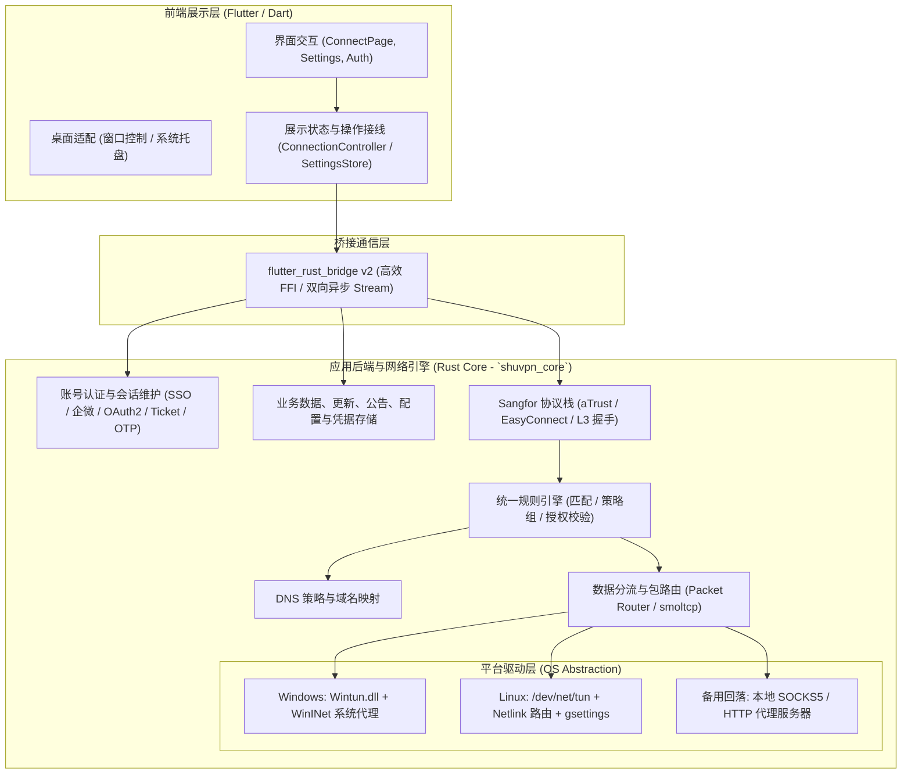
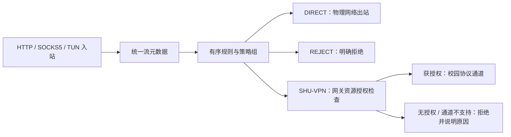

# ShuVPN 架构重构与桌面端迁移工程计划

2026-10-16 永久范围修订：**项目仅支持 Windows 与 Linux，不再开发或移植 Android。**
Android 工程、专用运行入口、原生适配与构建/发布工具已移除；下文 Android 内容只保留为历史记录，不属于待办或后续验收。
本次删除改变原生桥接接口，旧候选归档不代表当前源码，必须重新构建配套库、绑定与完整桌面包。

## （Rust 核心网络引擎 + Flutter 跨平台 GUI）

实际实施状态与验证证据见[实施记录](desktop_migration_progress.md)。

2026-10-14 本次交付范围修订：**本次仅交付 Windows 与 Linux 两个桌面版，Android 不属于本次交付或验收前置条件。** 下文保留跨平台长期规划；当前工作以桌面正式入口、Rust 后端、权限与网络恢复、桌面交互、完整分发包及其验证为准。Android 第三十三批动态路由及其回归移出本次关键路径。已经存在的 Android 源码和用户数据保持，桌面所用共享 Rust 代码仍需验证。

本次桌面交付验收：

- Windows 与 Linux 均从 `lib/main.dart` 构建，分发包包含 Flutter 数据、平台插件、配套 Rust 库及相应驱动/helper、许可证和启动说明。
- 桌面账户、设置、公告、认证、规则及连接使用 Rust 后端；完成桌面连接生命周期与 TUN/系统代理接线，不用 Android 分支代替桌面验收。
- 两端验证真实 FFI、持久化升级/退出/恢复、代理与规则、窗口/托盘、权限拒绝与网络清理；实际特权 TUN 和真实校园验收分别记录证据，未执行的项目不得标为通过。
- 提供可复现的桌面构建与打包入口、版本及校验摘要。安装与完整包启动需单独验证，旧构建或单个可执行文件不能代表当前交付。

2026-10-11 规划修订：参考 Clash Verge Rev 的规则管理交互与 Mihomo 的匹配语义，增加统一规则分流、策略组、规则集与 DNS 联动。新增项均为待实施规划，已有验收状态不因此变化。

2026-10-12 用户确认最终目标：**保留 Flutter 前端，应用后端业务全部迁入 Rust，最终删除 Dart 后端实现和旧 SDK 后台调用链**。最终范围为 Windows、Linux（2026-10-16 修订），不以桌面 VPN 主链路已接入 Rust 作为整项迁移完成证据。原有规则、平台、恢复、打包和校园验收要求全部保留。

---

## 1. 总体架构与职责划分



### 1.1 核心边界职责

| 层次 | 选型 | 核心职责 |
| :--- | :--- | :--- |
| **GUI 表现层** | **Flutter (Dart)** | 保持现有 UI 设计；负责页面、输入、交互、窗口/托盘展示、操作接线和 Rust 状态快照的展示；不拥有后端业务决策或后台网络请求。 |
| **桥接通信层** | **`flutter_rust_bridge` (FRB v2)** | 传递连接状态与实际流量；增加规则校验、预览、应用、回退、能力查询和命中事件接口。 |
| **应用后端层** | **Rust (`shuvpn_core`)** | 统一拥有认证、Cookie/凭据/会话、业务数据解析、配置与持久化、更新/公告服务、协议、DNS、规则、TUN/代理及连接生命周期与恢复。 |

### 1.2 后端零 Dart 的最终边界

- Dart 保留 Flutter 页面、输入收集、扫码/验证码展示、交互状态、平台界面事件及薄 FRB 适配。生成绑定和仅展示用的 DTO 可以保留。
- Rust 负责所有应用后台请求、认证协议、RSA/OTP 等业务计算、响应解析、Cookie/凭据管理、配置校验和持久化、连接取消/重试/超时策略、规则与系统网络恢复，并成为后台状态的唯一权威来源。
- 登录网页/WebView 属于交互界面；授权回调校验、验证码提交、Cookie 提取后的验证与入库由 Rust 完成。必要的平台桥接只传递输入、系统事件和文件描述符。
- ConnectionController、AccountCenter、SettingsStore 等 Dart 对象最终为展示适配器，只发送命令、订阅快照和管理界面订阅；不得另行判定凭据有效性、业务状态机、后端重试或网络清理策略。
- Rust 接入验证后删除已替代的 Dart 后端、运行期 SDK 后台依赖和后备调用链，包括停用代码；迁移尚未完成的模块必须在实施记录中明确列出。
- 持久化迁移保留既有账户与设置语义；必要时通过一次性旧数据导入交给 Rust，不能长期在两侧维护独立 Cookie/凭据/配置数据库。

具体残留入口和实施顺序见[后端迁移审计](backend_rust_migration_audit.md)。这是全项目最终要求，不将原目标缩减为单个平台或某一条连接路径。

---

## 2. 核心技术栈与 Crate 选型

### Rust 核心层依赖清单
- **异步运行时**：`tokio`（异步 I/O、任务调度）
- **HTTP / TLS 客户端**：`reqwest` / `rustls`（用于 SSO 认证、OAuth2、网关探测与环境上报）
- **数据包与虚拟网卡 (TUN)**：
  - Windows: `wintun` crate（官方/社区成熟绑定，直接操纵 Wintun ring buffer，性能与 WireGuard 相同）
  - Linux: `tun` crate 或直接调用 Linux `ioctl(TUNSETIFF)` + `rtnetlink`（配置 IP 与路由）
  - 用户态 TCP/IP（用于捕获流与分流）：`smoltcp`
- **系统代理配置（无虚拟网卡特权时的兜底方案）**：
  - Windows: `winreg`（注册表）或通过 FFI 调用 WinINet `InternetSetOptionW`
  - Linux: 通过 `gsettings` / `dconf` 命令行或 D-Bus 接口
- **加解密套件**：`rsa`, `aes`, `sha2`, `hex`, `base64`（兼容 aTrust 认证体系）
- **规则配置与索引（新增，依赖待选型）**：结构化规则模型、YAML 导入、域名索引与 IPv4/IPv6 CIDR 索引。先核对现有依赖再决定具体 crate；保持匹配器可脱离网络、GUI 与平台驱动测试。
- **参考边界**：Rust 核心继续为 `shuvpn_core`；借鉴 Clash Verge Rev 的规则编辑与配置覆写，以及 Mihomo 的规则语义。引入 Mihomo 进程、运行导入的 JavaScript 或承诺完整 Clash 配置兼容均不属于本次选型。

---

## 3. 分阶段实施里程碑 (Milestones)

### 阶段一：Rust 核心工作区搭建与桥接初始化（预计 3~5 天）
- [x] **M1.1 初始化 Rust crate**：在根目录下创建 `rust/` 目录，配置 `Cargo.toml` 与工作区。
- [x] **M1.2 引入 `flutter_rust_bridge`**：
  - 配置代码自动生成脚本（Codegen）。
  - 打通首个双向调用示例（Rust 生成日志/速率推送到 Dart，Dart 调用 Rust Ping 测通）。
- [x] **M1.3 平台编译流水线**：
  - 配置 CMake（Linux）与 MSBuild/Cargo（Windows）联合构建脚本。

### 阶段二：网络协议与认证链路下沉（预计 5~7 天）
- [ ] **M2.1 认证与 SSO 会话下沉**：
  - 将 `lib/core/auth/` 中的统一身份密码登录、挑战/验证码、企微扫码协议、业务 OAuth、aTrust、OTP 与教务请求/解析全部转为 Rust 实现。
  - Rust 统一拥有设备标识、Cookie、凭据有效性、会话导入/恢复/退出与持久化；Dart 仅展示认证快照并提交输入。
- [ ] **M2.2 aTrust 协议与数据通道实现**：
  - 实现基于 TLS 的 aTrust 控制信道握手与心跳。
  - 实现 L3 帧协议（解析与构造数据包分流）。
- [ ] **M2.3 用户态 SOCKS5 / HTTP 代理器**：
  - 在 Rust 侧启动轻量级本地代理服务器，为全平台提供无特权代理服务。
  - HTTP、SOCKS5 与后续 TUN 使用同一规则决策接口；实现真实 `DIRECT` 出站及 `REJECT`，避免所有代理请求固定走校园隧道。
- [ ] **M2.4 统一规则引擎与策略组（新增）**：
  - 实现有序、首条命中规则与 `DIRECT` / `REJECT` / `SHU-VPN` 动作。
  - 首批实现域名、IPv4/IPv6 CIDR、目标端口、网络协议、入站类型、`MATCH` 与 `no-resolve`。
  - 将网关资源表转换为自动校园规则，同时保留独立的网关授权检查；增加手动选择策略组和明确的未知策略错误。
- [ ] **M2.5 配置档、规则集与原子更新（新增）**：
  - 实现前置规则、配置档规则、自动校园规则、后置规则与最终兜底的确定顺序。
  - 支持 `RULE-SET`，第一批提供 `domain` / `ipcidr` / `classical` 的 YAML/text、inline/file/HTTPS 来源；更新失败保留最后有效版本。
  - 配置在校验、编译、预览后原子切换；保留上一版本及回退入口，更新订阅不覆盖用户修改。
- [ ] **M2.6 高级规则与兼容扩展（新增，基础引擎后实施）**：
  - 增加 `GEOIP` / `GEOSITE` 数据集、`AND` / `OR` / `NOT`、受限正则及规则集扩展格式。
  - 增加 `PROCESS-NAME` / `PROCESS-PATH` 等进程规则，按平台和入站能力启用；无法获取身份时不得展示为已生效。
  - 建立语法和能力兼容矩阵；完整代理协议订阅、任意脚本及未支持的 Mihomo 配置项须明确拒绝或提示映射，不能静默忽略。
- [ ] **M2.7 其余应用后端下沉（2026-10-12 新增）**：
  - 更新检查、版本判定、公告获取/解析、应用配置/schema 迁移及持久化进入 Rust。
  - 迁移正式支持协议的桌面后台网络/数据面，移除 Dart 代理、路由、流量统计和协议实现。
  - 各模块接线后删除旧实现及 SDK 后台调用；不可通过保留长期 Dart 后备路径完成验收。

### 阶段三：跨平台 TUN 虚拟网卡与系统配置集成（预计 7~10 天）
- [ ] **M3.1 Windows 平台适配**：
  - 集成 `wintun.dll`（可在安装包中携带），运行时初始化虚拟适配器。
  - 根据网关资源下发 IP 路由表，调用 Windows IP Helper API (`CreateIpForwardEntry2`) 自动添加校园网直连网段。
  - 实现一键 Windows 系统代理开关（注册表 `ProxyEnable` / `ProxyServer`）。
- [ ] **M3.2 Linux 平台适配**：
  - 实现打开 `/dev/net/tun` 创建虚拟网卡，通过 Netlink 配置 `ip addr` 与 `ip route`。
  - 实现针对 GNOME/KDE 桌面环境的系统代理配置联动。
- [ ] **M3.3 权限与保活**：
  - 桌面端针对需管理员权限操作（TUN 网卡与路由修改）提供友好的 UAC 触发或轻量 Helper 进程方案。
- [ ] **M3.4 TUN 规则路由与 DNS 联动（新增）**：
  - 默认采用校园分流捕获；只有进入 TUN 的流量才能执行核心规则，界面明确展示覆盖范围。
  - 将校园域名解析映射与授权网段动态编译为捕获路由，排除控制面和物理出站 socket，保证断线、更新与异常退出时恢复系统配置。
  - 在真实 DIRECT TCP/UDP、IPv6 能力、DNS 接管、出站保护和回滚均验证后，提供可选的完整流量捕获模式；进入 TUN 不等于全部送入校园隧道。

### 阶段四：Flutter 前端与桌面端交互改造（预计 3~5 天）
- [ ] **M4.1 引入桌面窗口与托盘管理**：
  - 添加 `window_manager`：设定最小尺寸、桌面无边框/自定义标题栏、支持“点击关闭隐藏到托盘”。
  - 添加 `system_tray`：Windows/Linux 任务栏托盘图标、右键菜单（连接、断开、切换协议、退出）。
- [ ] **M4.2 响应式布局优化**：
  - 将手机端的竖屏两段式抽屉在大屏桌面端调整为更加契合宽屏的左右分栏或紧凑型卡片。
- [ ] **M4.3 状态流无缝替换**：
  - `ConnectionController` 改为监听 Rust 吐出的事件流（Connecting, Connected, Disconnected, TrafficStats），原 UI 组件无需任何大规模修改即可直接响应。
  - AccountCenter、SettingsStore 与认证界面同样消费 Rust 权威快照，移除 Dart 后台业务状态机和独立存储。
- [ ] **M4.4 规则与连接管理界面（新增）**：
  - 参考 Clash Verge Rev：配置档卡片、规则新增/排序/启停、前置/后置规则、策略组选择、规则集更新和导入预览。
  - 展示规则来源、遮蔽原因、当前规则版本及平台能力；连接详情显示命中规则、期望动作、实际出站和授权拒绝原因。
  - 提供规则测试器，输入域名/IP、协议、端口与可用进程信息即可预览决策；校验失败保持旧配置运行。

### 阶段五：联调、测试与多平台打包（预计 3~5 天）
- [ ] **M5.1 连通性测试与内存泄露排查**：
  - 针对校园内网核心站点（JWXT、OA、知网、校内 Git、内网穿透目标）进行长时间压测与断线重连测试。
- [ ] **M5.2 CI/CD 与打包分发**：
  - Windows：使用 Inno Setup 或 MSIX 生成安装包，打包包含 Flutter 产物、Rust DLL、Wintun.dll。
  - Linux：生成 AppImage、deb 包或 Flatpak。
- [ ] **M5.3 分流一致性与回滚验收（新增）**：
  - HTTP/SOCKS5/TUN 的相同流元数据须得到相同规则决策；测试首条命中、配置覆写、规则集更新、DNS、授权与实际出站。
  - 验证默认校园分流与可选完整捕获的覆盖范围、控制面防回环、IPv6/UDP 能力、热更新、断线和崩溃恢复。
  - 用独立的直连、网关和拒绝端点证明实际路径；不得以命中日志或纯匹配单测代替端到端证明。
- [ ] **M5.4 后端零 Dart 验收（2026-10-12 新增）**：
  - 逐文件审计所有生产 Dart 代码、依赖及平台条件分支，确认只保留前端、生成绑定、展示 DTO 和必要的薄适配。
  - 生产 Dart 中后台 HTTP/Socket、Cookie/凭据计算和存储、业务解析、协议/路由/数据面、业务重试/超时/清理策略残留为零；框架平台接口例外须明确且不能含业务实现。
  - Windows、Linux 分别验证同一 Rust 后端，真实 FFI、正式产物和持久化升级/退出/恢复均有证据。
  - 静态审计与运行期证据共同证明正式路径不再执行旧 Dart 后端；仅入口切换、目录改名或注释旧代码不能验收。

新增顺序：M2.3 的入站先调用统一决策接口，M2.4/M2.5 在 M3.4 与 M4.4 接入前完成；M2.6 依赖基础引擎和平台身份能力。原有工期估算未包含新增规则系统，需在 M2.4/M2.5 接口和测试向量确定后重新估算。

后端零 Dart 补充顺序：先迁移账号会话/Cookie 与完整 SSO，再迁移业务凭据/OTP/教务，随后处理更新/公告/配置持久化和桌面薄前端接线，最后删除旧后端并执行 M5.4。既有平台适配和正在验证的工作继续保留，不用此前局部测试结果证明这些新增项完成；原工期也不作为扩大范围后的交付承诺。

---

## 4. 关键技术细节与方案设计

### 4.1 通信层架构：Dart 与 Rust 的流式桥接示例

在 `rust/src/api/vpn.rs` 中定义轻量级接口：
```rust
pub struct VpnConfig {
    pub server: String,
    pub ticket: String,
    pub use_tun: bool,
    pub http_proxy_port: u16,
    pub socks_proxy_port: u16,
}

pub enum VpnEvent {
    StateChanged(VpnState),
    TrafficUpdate { upload_bps: u64, download_bps: u64, rtt_ms: u32 },
    Error(String),
}

// Dart 侧调用此方法，并持续监听 stream
pub fn start_vpn(config: VpnConfig, stream: StreamSink<VpnEvent>) -> Result<()> {
    // 启动 Tokio 任务，建立隧道，监听虚拟网卡或代理服务
    // 定时向 stream 发送状态更新
}
```

Dart 侧在 `connection_controller.dart` 中优雅消费：
```dart
final stream = startVpn(config: rustConfig);
stream.listen((event) {
  switch (event) {
    case VpnEvent_TrafficUpdate(:final uploadBps, :final downloadBps, :final rttMs):
      _updateTraffic(uploadBps, downloadBps, rttMs);
    case VpnEvent_StateChanged(:final state):
      _transitionTo(state);
    // ...
  }
});
```

### 4.2 统一分流模型与校园授权边界

参考 Clash Verge Rev 的规则编辑与前置/后置配置方式，并采用 Mihomo 的有序匹配约定。ShuVPN 的具体设计如下；新增模块、接口与配置格式均为计划项，不能据此认定当前实现已经支持。



流元数据包括目标域名、已知目标 IP、端口、TCP/UDP、入站类型，以及平台确实可提供的进程/包信息。规则产生 `RouteDecision`（拟新增模型），包含规则 ID、来源、配置版本、策略组、期望动作和原因；实际拨号再记录最终出站、网关资源 ID 和结果。

`SHU-VPN` 表示当前可用的校园连接，仍受网关资源、协议和端口授权限制。用户规则不能扩大授权；即使 `MATCH,SHU-VPN` 命中，无授权或无通道能力时也须拒绝。校园隧道断开、拨号失败或拒绝后，不自动改为 DIRECT，也不继续匹配较低优先级规则。此失败处理是 ShuVPN 的明确约束，兼容矩阵须注明与其他内核的能力回退行为差异。

### 4.3 规则语法、优先级与默认策略

基础兼容集：

| 类型 | ShuVPN 计划语义 |
| --- | --- |
| `DOMAIN` | 完整域名匹配，统一大小写、末尾点及 IDNA 表示 |
| `DOMAIN-SUFFIX` | 匹配域名本身和以点为边界的子域；`shu.edu.cn` 不匹配 `evilshu.edu.cn` |
| `DOMAIN-KEYWORD` | 域名关键词匹配 |
| `IP-CIDR` / `IP-CIDR6` | IPv4/IPv6 网段；缺少 IP 时按 DNS 策略解析 |
| `DST-PORT`、`NETWORK`、`IN-TYPE` | 匹配端口/范围、TCP/UDP、HTTP/SOCKS/TUN 入站 |
| `RULE-SET` | 在当前位置引用指定规则集，匹配后使用该条规则的策略 |
| `MATCH` | 最终兜底；有效配置只允许一个最终 MATCH |
| `no-resolve` | 未知目标 IP 时不为该 IP 规则额外解析；已有 IP 仍可匹配 |

有效规则列表按以下顺序组装，然后从上到下首条命中：

1. 用户前置规则。
2. 当前配置档/导入配置的规则及其 `RULE-SET` 引用。
3. 根据网关资源生成的校园规则。
4. 用户后置规则。
5. 配置档最终 `MATCH`。

控制面防回环、监听限制和校园授权是独立约束，不是可由前置规则覆盖的普通规则。导入配置中的 MATCH 须归一为最后一条并展示变更；中途终结、重复 MATCH、未知规则、无效 CIDR、缺失规则集和未知策略组在应用前报错。用户可以显式将校园目标设为 DIRECT，但界面须显示对自动校园规则的遮蔽结果。

新配置档默认采用规则模式：自动校园规则选择 `SHU-VPN`，其余流量 `MATCH,DIRECT`。保留可选的“仅校园”配置档，以 `MATCH,REJECT` 维持未匹配即拒绝的行为。已有配置保持旧语义；迁移时提供这两个配置档的预览和选择，不能将旧的严格代理自动改为直连。

基础策略组为手动选择组，可指向 DIRECT、REJECT 或已接入的校园协议连接；导入的组名需要用户明确映射到可用出站。后续增加规则/全局校园隧道/全局直连模式，模式选择不绕过网关授权与系统保护。自动测速、回退组与其他代理协议按能力矩阵扩展，未支持的节点不会被冒充为校园出站。

以下示例为计划中的配置档片段，`shu-campus` 是拟新增的网关自动规则集名称；未实现前不能直接投入运行：

```yaml
rules:
  - DOMAIN-SUFFIX,shu.edu.cn,SHU-VPN
  - RULE-SET,shu-campus,SHU-VPN
  - IP-CIDR,127.0.0.0/8,DIRECT,no-resolve
  - IP-CIDR6,::1/128,DIRECT,no-resolve
  - MATCH,DIRECT
```

校园规则须位于通用私网 DIRECT 规则之前，避免将获授权的校内 `10.x` 目标误判为普通局域网。最终是否能走 SHU-VPN 仍由独立授权检查决定。

### 4.4 配置档、规则集、模块边界与更新

- 配置原文、全局用户覆写、配置档专属覆写和编译后的有效快照分开保存；订阅更新保留前置/后置编辑。列表覆写使用明确的替换/插入操作，预览显示最终顺序及每条来源。
- `rule-providers` 首批支持 inline/file/HTTPS 来源以及 domain/ipcidr/classical 的 YAML/text 内容；远端下载设置大小、超时与条数限制，文件仅位于应用规则目录。更新失败保留最后有效快照，首次缺少必需规则集时应用失败。
- GeoIP/GeoSite、正则和逻辑规则分别规定数据集版本、表达式预算与最大嵌套深度；缓存或订阅内容只当作数据解析，不运行 JavaScript。
- 在现有 `rust/src/connection/` 接入决策边界，拟新增 `rust/src/routing/` 持有规则模型、匹配器、策略组和授权组合；拟新增规则配置/下载适配器只负责外部 I/O。不能在各代理和 TUN 中继续复制独立匹配逻辑。
- 复用现有网关资源、节点组和授权匹配知识，将资源表作为编译输入；规则选择出站与网关选择 appId/nodeGroup 是两个阶段。FRB 的规则预览/应用接口和 Flutter 设置页面为拟新增接线。
- 校验与编译成功后原子发布版本；新流使用新版本，已有流保留建立时的决策。拒绝规则变更是否主动终止旧流须由显式“立即断开受影响连接”操作控制；异常更新可回退至上一有效版本。

### 4.5 DNS、TUN 捕获范围与进程能力

- HTTP CONNECT/SOCKS5 提供域名时先评估域名规则；命中校园出站且网关支持按域名拨号时，将域名交给网关。需要目标 IP 时使用对应解析策略：校园名称优先经授权隧道 DNS，DIRECT 使用物理网络解析器。
- 校园 DNS 不可用时返回明确失败，不静默改用公共 DNS。解析结果携带来源、TTL 和配置版本，避免校园/直连缓存混用；`no-resolve` 不触发额外查询。
- 默认 TUN 仍采用校园分流捕获，物理默认路由保持不变。捕获集由授权网段和校园域名的有效地址映射生成；不能将域名、端口、进程条件直接假装为 OS 的 CIDR 路由。
- 广泛的 IP、端口、拒绝或进程规则若覆盖捕获集外的流量，默认 TUN 模式无法执行，界面必须显示“未被接管”。完整捕获作为独立可选模式，在 DIRECT TCP/UDP/IPv6、DNS 接管和系统恢复验证后启用；公网流量由核心 DIRECT 出站送回物理接口，而非送入校园网关。
- SSO、隧道节点、引擎自身连接和规则集更新通道须有明确的物理出站/防回环处理。域名映射更新、网络切换、TTL 到期与退出均要同步清理新增路由，完整捕获失败时按事务恢复系统网络。
- 首批采用真实 IP 与 DNS 映射；fake-IP、HTTP/TLS 域名嗅探为后续能力，需独立验证映射回收、歧义处理、平台覆盖和无法取得域名时的行为。
- 进程/包信息通过平台适配器查询并标记可信度；远端 LAN 代理客户端等入站不能提供本机进程身份时，规则启用须明确报出能力不支持或要求用户选择可解释的降级配置，不能以空身份当成匹配成功。

### 4.6 风险与验证门槛

规则系统与出站选择按 HIGH 风险实施，影响实际网络路径与系统配置。每项规则类型需要正例、反例和边界向量；核心语义以官方文档为参考，ShuVPN 的授权及失败处理使用独立测试。

- 匹配：首条命中、后缀边界、大小写/IDNA、IPv4/IPv6、端口、入站、缺失元数据及 no-resolve。
- 组合：前置/后置、校园规则顺序、策略组映射、无效导入、重复 MATCH、同名规则集、更新失败、原子切换和回退。
- 实际出站：DIRECT 使用物理连接，SHU-VPN 使用获授权通道，REJECT 不建立目标连接；超出授权、隧道掉线和不支持 UDP 时没有隐式直连。
- 一致性：HTTP/SOCKS5/TUN 输入相同已知元数据得到相同决策；未被 TUN 捕获的流量不能伪造命中统计。
- 系统：DNS 泄漏/回环、动态路由生命周期、完整捕获退出、权限拒绝、崩溃恢复与断线重连。

运行受影响的 Rust 单元/集成测试、真实 FFI 测试、Flutter 全量测试与两端构建；平台路径在隔离网络或实机验证。回退须同时恢复上一规则快照、路由/DNS/系统代理状态，并释放新增连接；保留原校园配置档和既有会话数据格式。

### 4.7 参考资料与兼容范围

以下为 2026-10-11 核对的官方资料。前置/后置编辑参考 Clash Verge Rev；规则类型、首条命中、no-resolve 与规则集格式参考 Mihomo。ShuVPN 的规则优先级分层、校园授权限制、默认配置档、模块划分与验收流程是本项目设计。

- [Clash Verge Rev 项目](https://github.com/clash-verge-rev/clash-verge-rev)
- [Clash Verge Rev：自定义规则](https://www.clashverge.dev/guide/rules.html)
- [Clash Verge Rev：扩展配置与脚本](https://www.clashverge.dev/guide/extend.html)
- [Mihomo：路由规则](https://wiki.metacubex.one/config/rules/)
- [Mihomo：规则集合](https://wiki.metacubex.one/config/rule-providers/)
- [Mihomo：TUN](https://wiki.metacubex.one/config/inbound/tun/)

M2.4/M2.5 交付基础兼容集；M2.6/M3.4 交付高级规则与平台接管能力。界面和导入器需逐项显示支持状态，不能仅凭接受 Clash 风格的规则字符串就宣称完整兼容。

---

## 5. 风险与应对方案

| 潜在风险 | 影响程度 | 解决方案 |
| :--- | :--- | :--- |
| **Windows 管理员特权 (UAC)** | 中 | 1. 优先提供“免特权系统代理模式”（修改注册表无需 UAC，普通用户即可开箱即用）；<br>2. TUN 模式在启动时检测管理员权限并按需触发 UAC 提权。 |
| **Linux 桌面环境多样性 (X11 / Wayland / GNOME / KDE)** | 中 | 统一通过系统代理抽象脚本适配主流环境；TUN 模式依赖标准的 Linux Network Namespace 或 `setcap cap_net_admin+ep` 提权。 |
| **跨平台 C/Rust 动态库构建复杂度** | 低 | 借助 `flutter_rust_bridge` 的模板化构建流程，配合 GitHub Actions 矩阵实现自动化多端编译。 |
| **规则语义与校园授权混淆** | 高 | 将出站选择与网关授权分开；未获授权的 SHU-VPN 连接拒绝，不自动改为 DIRECT。 |
| **TUN 捕获范围与界面承诺不一致** | 高 | 明示校园分流/完整捕获范围；未接管流量不计规则命中，完整捕获上线前验证物理出站、防回环和事务恢复。 |
| **规则集更新、DNS 与进程元数据不可靠** | 中 | 校验后原子更新并可回退；缓存按来源隔离；不支持的语法或平台能力在启用前明确报错。 |
